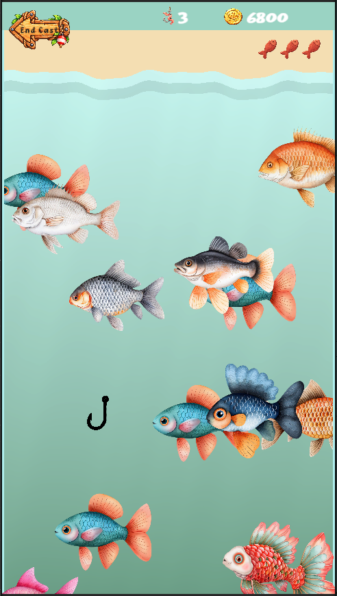

# Nibble Fish

**Independent Mobile Software Project | Unity • C# • Android • Git/GitHub**

Nibble Fish is an independently designed and developed mobile game project built in Unity for Android.

The project has been developed from initial concept through iterative implementation, with a focus on reusable gameplay systems, data-driven design, progression, user experience, debugging, and maintainable code.

> **Project Status:** In active development  
> **Source Code:** Private development repository. This public repository documents the project, technical decisions, and selected portfolio-safe examples.

---

## Project Overview

Nibble Fish is a fishing-themed collection game in which players navigate underwater environments, collect fish, manage resources, and progress through increasingly challenging fishing locations.

Rather than building the project as a collection of isolated game mechanics, I have focused on creating reusable systems that can support future content and progression.

Development has included translating gameplay ideas into technical requirements, implementing and testing features, debugging interactions between systems, and revising designs when early approaches created unnecessary complexity.

---

## Screenshots

### Pond Gameplay

Core fishing gameplay in the Pond environment, showing the player navigating around fish during an active fishing turn.

### Fish Collection

Collection interface used to track discovered fish and support longer-term progression and completion goals.

### Shop & Upgrades

Shop interface showing resource management and progression systems, including permanent upgrades and future unlockable features.

---

## Technologies

- Unity
- C#
- Android
- Git / GitHub
- Object-Oriented Programming
- ScriptableObjects
- Data-driven game design
- Persistent game state
- Iterative software development

---

## Technical Highlights

- Designed reusable C# gameplay systems rather than hard-coding behavior for individual game objects, improving maintainability as new fish, locations, and progression features are added.
- Used Unity ScriptableObjects to separate fish data from gameplay logic, allowing content such as rarity, size classification, collection information, and gameplay values to be managed independently from code.
- Developed a reusable fish spawning system that maintains a configurable fish pool, limits the number of active fish, and distributes initial spawns across evenly divided vertical zones to avoid clustering.
- Implemented player movement, collision handling, collection behavior, spawning, progression, shop interactions, and persistent game-state systems.
- Designed Bait as a gameplay resource required to begin each fishing turn and incorporated resource availability into the player flow.
- Structured upgrades as progression systems, including permanent upgrades that unlock as players advance to new fishing locations.
- Debugged interactions between interconnected gameplay systems and refactored designs when early implementations introduced unnecessary complexity.
- Managed the project iteratively from original product concept through requirements, implementation, testing, revision, and scope prioritization.

---

### Selected Code Samples

#### [`FishData.cs`](code-samples/FishData.cs)
Demonstrates the data-driven structure used to define fish identity, rarity, biome, size classification, gameplay values, and visual assets through Unity ScriptableObjects.

This allows fish content to be expanded and maintained without hard-coding individual fish configuration into gameplay systems.

#### [`HaulReviewManager.cs`](code-samples/HaulReviewManager.cs)
Demonstrates collection and progression logic after a fishing turn. The system calculates rewards, identifies genuinely new fish discoveries, prevents duplicate reveal events within the same haul, updates persistent discovery state, and transitions the player from individual catch reveals to a final haul summary.

#### [`DiscoveryData.cs`](code-samples/DiscoveryData.cs)
Demonstrates persistent collection-state management using a `HashSet` to prevent duplicate fish discoveries and Unity `PlayerPrefs` to save and restore discovered fish identifiers between sessions.

The system only writes updated discovery data when a genuinely new fish is found, keeping the collection state synchronized with the player's progress.

---

## Systems Developed

### Fish Data System

Fish characteristics are stored using reusable data objects rather than being hard-coded into individual gameplay scripts.

This supports properties such as:

- Fish identity
- Rarity
- Size classification
- Collection information
- Gameplay values
- Biome association

This approach separates game content from gameplay logic and makes fish data easier to maintain and expand.

### Fish Spawning

The spawning system uses a configurable pool of FishData assets to determine which fish can appear during a scene.

Initial fish are distributed across evenly divided vertical spawn zones while horizontal positions are randomized. The system also limits the number of active fish and assigns each spawned object a FishData asset from the configured pool.

### Player Movement & Collision

Gameplay systems manage player movement, collision handling, and limited collision lives during fishing turns.

Collision behavior is designed to interact with progression systems and permanent upgrades.

### Collection & Progression

Collected fish contribute to longer-term player progression and collection goals.

The game is being designed so that progression introduces new environments, fish, mechanics, and upgrades rather than simply increasing numerical difficulty.

### Resource & Upgrade Systems

Gameplay includes resource-management and progression mechanics such as:

- Bait required to begin a fishing turn
- Permanent upgrades
- Location-based progression
- Shop interactions
- Future unlockable gameplay improvements

These systems are designed to create meaningful progression while keeping individual gameplay sessions easy to understand.

### Persistent Game State

Persistent-state systems retain relevant player progress between gameplay sessions.

This requires coordinating game data, progression state, and scene transitions without tightly coupling unrelated gameplay systems.

---

## Development Approach

Nibble Fish is also a practical exercise in iterative software development.

The development process includes:

1. Defining the intended player experience
2. Breaking features into smaller technical requirements
3. Implementing a functional version
4. Testing system interactions
5. Identifying unnecessary complexity
6. Refactoring designs where needed
7. Expanding the system only after the core behavior is stable

Several systems have been redesigned during development when a simpler architecture provided better maintainability or clearer gameplay behavior.

---

## What This Project Demonstrates

This project demonstrates experience with:

- Designing software from an original concept
- Translating product requirements into technical features
- Writing and debugging C# code
- Working with object-oriented systems
- Creating reusable data models
- Managing interactions between multiple gameplay systems
- Using Git and source control throughout development
- Iteratively refining software architecture
- Prioritizing features and controlling project scope
- Developing software independently over an extended period

---

## Portfolio Roadmap

This public case study will be expanded as development progresses.

Planned additions include:

- Architecture diagrams
- Selected sanitized C# examples
- System design explanations
- Development milestones
- Technical challenges and solutions
- Android build/demo information

---

## About the Repository

The complete Nibble Fish development repository remains private because it contains the full application source code, project assets, configuration, and unreleased game design.

This repository is intended to provide a technical portfolio view of the project without distributing the complete product.
